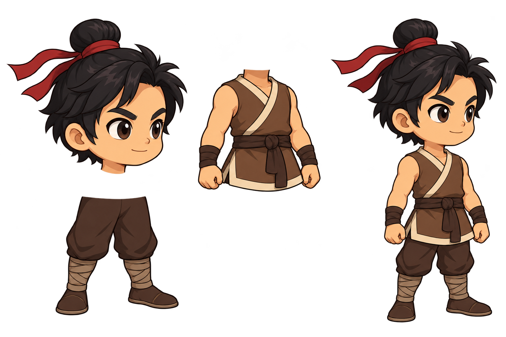
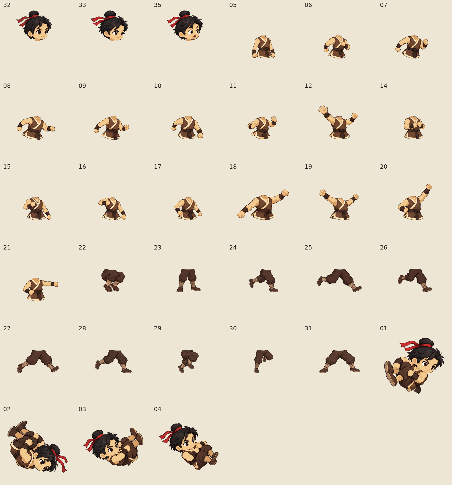
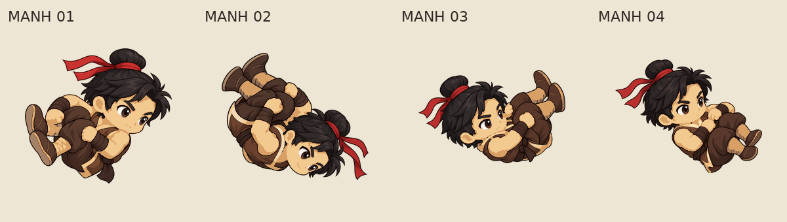
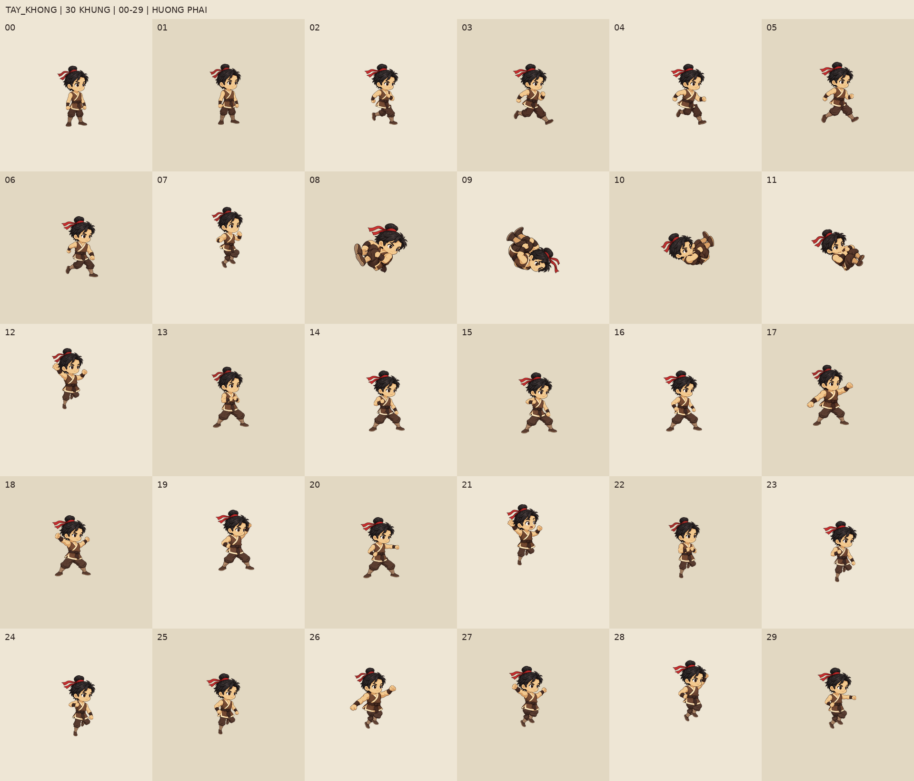
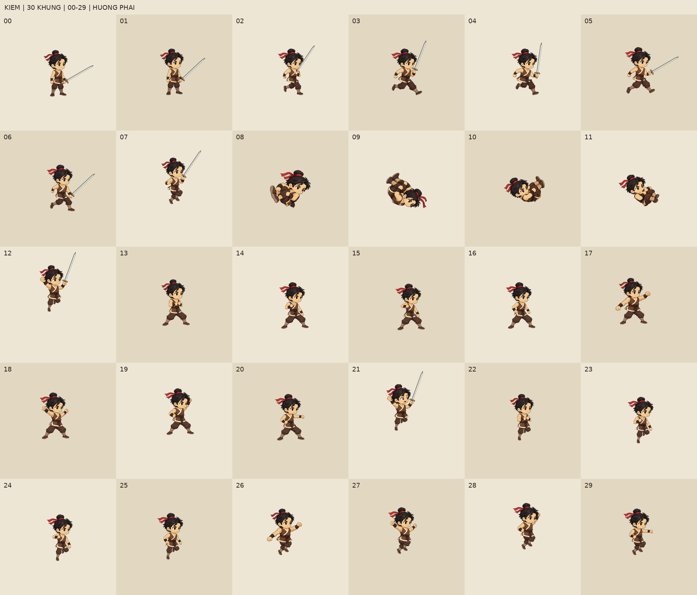
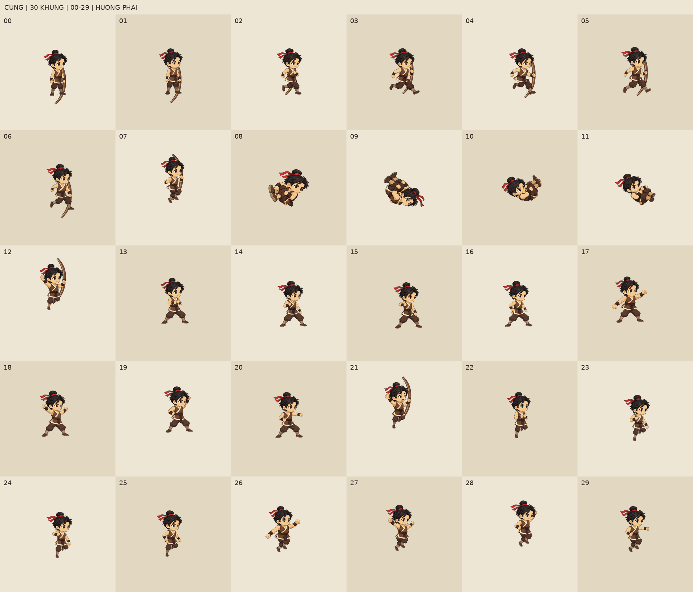

# Đinh Bộ Lĩnh Lv1 — bộ tạo bằng công cụ ảnh

[Tải ZIP bộ mới, khoảng 45 MB](https://github.com/DVSoai/design/raw/refs/heads/main/dbl_lv1.zip) · [Xem REPORT và số lần gọi từng mảnh](REPORT.md)

33 mảnh nhân vật được tạo bằng công cụ tạo ảnh, bám ba mẫu đã duyệt. SVG chỉ dùng cho kiếm và cung. Báo cáo ghi số lần gọi thực tế: 33 lần mới, cộng một lần atlas mẫu gốc dùng chung; mọi mảnh nhân vật đều có ít nhất một lần gọi.

Bộ xuất có 30 khung × 3 biến thể, hai hướng và hai cỡ. Vũ khí **chỉ hiện ở 00–07, 12, 21**. Những khung còn lại của biến thể kiếm/cung giống tay không theo yêu cầu. Bốn khung lộn dùng bốn ảnh toàn thân được tạo riêng.

ZIP gồm mảnh PNG nền trong 256/128px, raster gốc để xử lý lại, khung ghép, SVG vũ khí, sheet, GIF, công cụ, prompt nguyên văn và báo cáo kiểm tra.

## Mẫu đã duyệt

## 33 mảnh nhân vật

## Bốn mảnh lộn riêng

Mảnh lộn 02 được dùng ở khung 09, có đầu chúc xuống và chân cuộn lên.

Mỗi bảng dưới có 30 khung đánh số 00–29, đọc trái sang phải, trên xuống dưới: 6 cột × 5 hàng, hướng phải.

## Tay không

## Cầm kiếm

## Cầm cung

