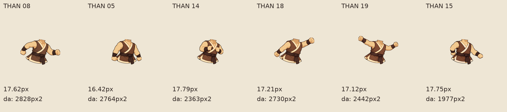

# Đinh Bộ Lĩnh Lv1 — vũ khí và tay đồng bộ

[**Tải ZIP mới — khoảng 68 MB**](https://github.com/DVSoai/design/raw/refs/heads/main/dbl_lv1.zip) · [**REPORT: góc, kích thước, tay và output script**](REPORT.md)

Kiếm và cung dùng đúng tọa độ bảng khung cùng độ lệch mảnh, không xoay lúc ghép. Kiếm chĩa xuống-trái, cung chéo lên-phải; vũ khí trên thân, lớp ngón tay trên chuôi. Chỉ hiện ở **00–07, 12, 21**.

Khung bao nguồn: kiếm **199×117px**, cung **170×258px**; lệch góc so với ảnh hướng dẫn khoảng **0,24° / 2,02°**. Đủ 80 kiểm tra hai hướng, hai cỡ. Cung đứng 00–01 không thấp hơn bàn chân.

Đã tạo lại thân **15, 17** và đồng bộ tay **5, 14, 18, 19** bằng công cụ ảnh. Ngưỡng ±12% áp cho độ dày trung bình; diện tích da ghi riêng theo dáng theo lựa chọn của người dùng. Lớp tay cầm riêng chỉ dùng ở biến thể vũ khí. **156 PNG được bảo vệ không đổi**, gồm các mảnh còn lại và toàn bộ lộn 08–11.

Thân **16** giữ nguyên; giữa bắp tay trái bị che nên phép đo ghi **N/A**, không coi là Đạt. Các số đo từng bên, diện tích và số lần gọi công cụ ảnh nằm trong REPORT.

## Tay đồng bộ và thân đánh

## Tay không — 30 khung

## Kiếm — 30 khung

## Cung — 30 khung

## Các mảnh nhân vật

ZIP giữ cấu trúc cũ, có PNG hai cỡ/hướng, SVG vũ khí, raster gốc và lớp tay, sheet, GIF, tools, prompts và REPORT. Ảnh đối chiếu bên ngoài chỉ lưu trong thư mục tạm, không đưa vào ZIP hay repo.
